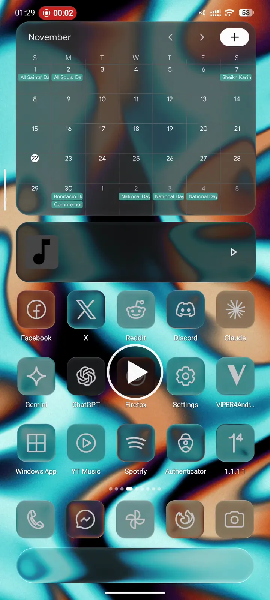
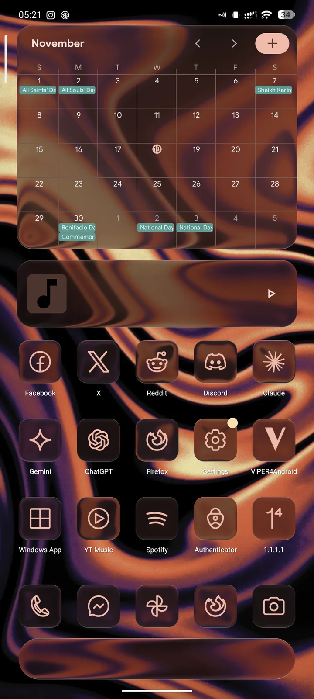
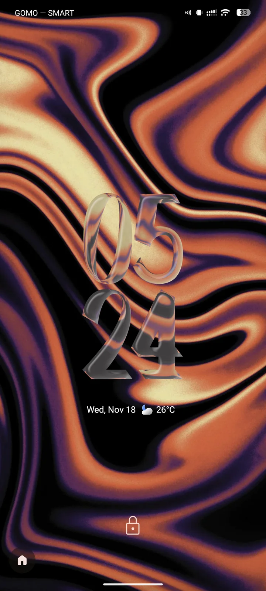
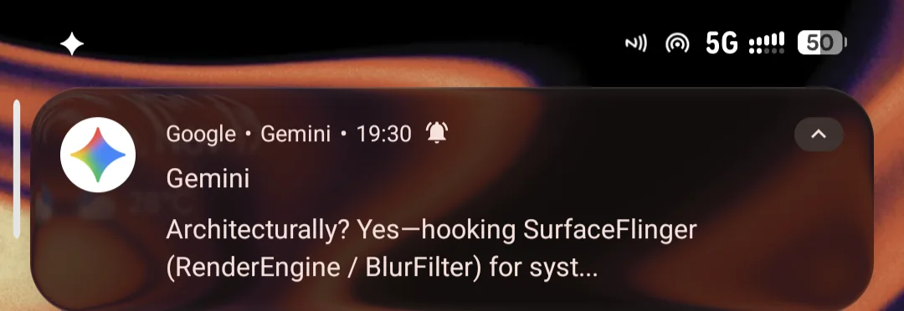
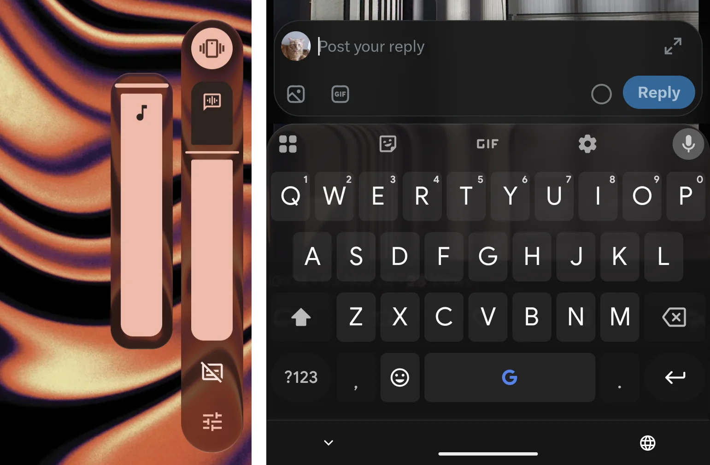
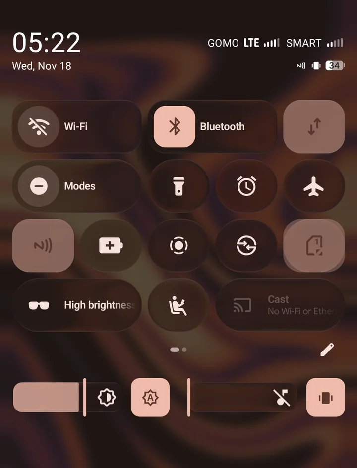
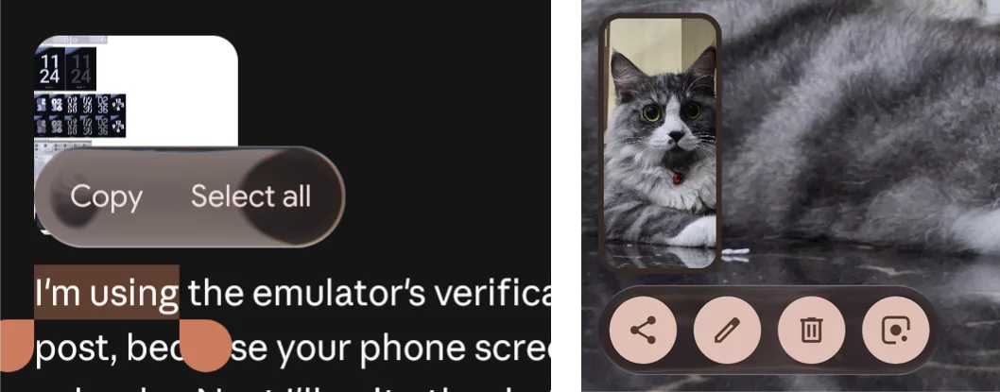

# Liquid Glass for Android

Apple's Liquid Glass, drawn by Android's own compositor. A root module hooks
one function in SurfaceFlinger, `BlurFilter::drawBlurRegion`, and draws
refracting glass wherever the system already blurs something: notification
cards, the volume panel, blurred dialogs and, if you want, the shade behind
them. Nothing is themed and no app is patched. Switch it off and Android's blur
comes back, pixel for pixel.

An optional LSPosed companion makes glass of surfaces that have no blur of
their own:
- Quick Settings tiles;
- the launcher's icons, folders, widgets and search box;
- heads-up notifications;
- sliders, the text selection toolbar, toasts and the screenshot UI;
- the lockscreen clock.

There's a write-up of how it works on my site:
[Liquid Glass inside Android's compositor](https://capthnds.me/blog/liquid-glass-android/).

## See it in action

<p align="center">
  <a href="https://bnlg.capthnds.me/TMOX7gByb5BebXsyqA/liquid-glass-android-demo.mp4">
    
  </a>
</p>

The picture opens a half-minute screen recording from my phone, with a
fluid simulation as the live wallpaper. The wallpaper changes every
frame, so SurfaceFlinger redraws all the glass above it every frame too.
At 0:17 the app drawer opens, with about 40 glass icons on screen at
once.

## Screenshots

From a Poco F3 on crDroid 13.1, Android 17.

<p>
  
  
</p>
<p>
  
</p>
<p>
  
</p>
<p align="center">
  
</p>
<p>
  
</p>

## Download

| Build | Where |
|---|---|
| Module | [The latest release](https://github.com/capthndsme/liquid-glass-android/releases/latest), with its sha256 |
| [Companion APK, 0.1](https://bnlg.capthnds.me/X1l-_U6YeApbAXKOM3/stockglass-companion.apk) | sha256 `baa9efa6ba9591560aba6c5be6ef16cdeaa1bad83a582767974823eea9783774` |

GitHub Actions builds every push to this repository and publishes it under
[Releases](https://github.com/capthndsme/liquid-glass-android/releases). The
latest release is the newest numbered version. A build between two versions is
a pre-release named like `v0.4.20-3-g1a2b3c4`, and the module in it reports
that name. When a release has a companion APK attached, take that one.

It's experimental and needs root on Android 14 to 17. The installer checks the
ROM's SurfaceFlinger first and refuses to install if the engine can't drive it.
If a boot ever fails with the module installed, it disables itself on the next
boot.

1. Flash the module zip in KernelSU, Magisk or APatch, and reboot. KernelSU 3
   also needs a metamodule such as meta-overlayfs.
2. Turn glass on with the module's Action button, its WebUI or
   `sh /data/adb/modules/stockglass/glassctl glass`. Glass is off until you do.
3. For the companion, install the APK and enable it in LSPosed with System UI
   and your launcher in its scope. Then reboot.

[module/README.md](module/README.md) and
[companion/README.md](companion/README.md) cover the settings and each
surface's requirements. For example, app icons get glass only when they are
themed.

## What's here

| Path | What it is |
|---|---|
| `module/` | The KernelSU / Magisk / APatch module: the installer, boot scripts, `glassctl` and the WebUI. |
| `engine/` | `libglassengine.so`, which loads into SurfaceFlinger. It resolves Skia's symbols from the ROM's own binary, hooks the blur and draws the glass. |
| `shader/` | Generates the glass shader (SkSL) that the engine embeds. |
| `companion/` | The LSPosed module. |
| `harness/` | A test app that makes blur regions on demand. |
| `docs/` | [ARCHITECTURE.md](docs/ARCHITECTURE.md) explains the design. [VERIFIED.md](docs/VERIFIED.md) records what was tested where, with numbers. |

## Building

You need Android NDK 29.0.14206865 and Python 3. Set `ANDROID_NDK` if the NDK
isn't at `$HOME/Android/Sdk/ndk/29.0.14206865`. The companion also needs the
Android SDK (build-tools 36.0.0, platform android-33) and a JDK.

```sh
engine/vendor/fetch_skia_headers.sh
engine/vendor/fetch_xz.sh
engine/vendor/fetch_frida_gum.sh
engine/test/host.sh  # the tests that need no device
module/pack.sh       # module/out/stockglass-v<version>.zip
companion/build.sh   # companion/out/stockglass-companion.apk
```

The fetch scripts take pinned commits and checked archives, so a build made
elsewhere compiles the same third-party code. The release workflow
(`.github/workflows/release.yml`) runs these same scripts.

## Credits

- The glass maths comes from Kyant's
  [AndroidLiquidGlass](https://github.com/Kyant0/AndroidLiquidGlass)
  (Apache-2.0), by way of the Android port in
  [expo-liquid-glass-ui](https://github.com/capthndsme/expo-liquid-glass-ui).
  `shader/gen_glass_sksl.py` marks the derived portions.
- These are fetched at build time, not kept in this repo:
  - [Frida Gum](https://github.com/frida/frida-gum), for the hook;
  - [XZ Embedded](https://tukaani.org/xz/embedded.html), to read the ROM's
    compressed debug info;
  - [patchelf](https://github.com/NixOS/patchelf);
  - Skia's headers.
